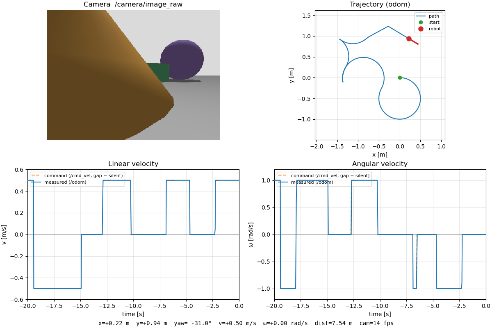

# FOSSBot Control Interface

ROS 2 (Jazzy) interface for driving the [FOSSBot](https://github.com/eellak/fossbot) mobile robot —
by clicking in a camera window, by hand gestures, with a live dashboard of the robot's state.
Works the same in the Gazebo simulation and on the physical robot, because both expose the
same topics (`/cmd_vel`, `/odom`, `/scan`, `/camera/image_raw`).

Project for the *Introduction to Robotics* course at Poznań University of Technology.

## Features

- [x] **Click teleoperation** – click above the centre line to drive forward, below to drive
      backward; speed grows with the distance from the centre
- [x] **Launch file + YAML parameters** – one command starts all nodes with their settings
- [x] **Live dashboard** – camera image, XY trajectory and commanded vs measured velocity
      in real time
- [ ] **Gesture control** – two hand gestures (MediaPipe) trigger 360° rotations
- [ ] **Docker Compose** – driver container (sim *or* real robot + camera) and an interface container

## Architecture

```mermaid
flowchart LR
    cam[usb_cam<br/>laptop camera] -- /user_cam/image_raw --> click[click_teleop]
    click -- /cmd_vel --> robot[FOSSBot<br/>Gazebo sim or fossbot_bridge]
    click -. /fossbot/enable_motors .-> robot
    robot -- /odom --> dash[dashboard]
    robot -- /camera/image_raw --> dash
    click -- /cmd_vel --> dash
```

The dashboard only subscribes, so it works next to any controller (click teleop,
gestures, `teleop_twist_keyboard`, Nav2).

## Requirements

- Ubuntu 24.04 + ROS 2 Jazzy (or the FOSSBotEduSim container)
- Python packages: `opencv`, `numpy`, `matplotlib`, `PyQt5` (all installed with ROS desktop)
- Optional: [`usb_cam`](https://github.com/ros-drivers/usb_cam) for the laptop camera
  (`sudo apt install ros-jazzy-usb-cam`)

## Build

```bash
mkdir -p ~/ros2_ws/src && cd ~/ros2_ws/src
git clone https://github.com/wiktor77887-bit/fossbot-control-interface.git
cd ~/ros2_ws
colcon build --symlink-install --packages-select fossbot_control_interface
source install/setup.bash
```

## Run

### In simulation

```bash
# terminal 1 – simulator (inside FOSSBotEduSim)
ros2 launch fossbot_educational_description single.launch.py world:=simple_shapes.sdf

# terminal 2 – interface (+ laptop camera)
ros2 launch fossbot_control_interface interface.launch.py start_camera:=true
```

### On the real robot

Start the [fossbot-ros2-bridge](https://github.com/LRMPUT/fossbot-ros2-bridge) as described in the lab
instructions, then in every terminal:

```bash
export ROS_DOMAIN_ID=1
ros2 launch fossbot_control_interface interface.launch.py use_real_robot:=true start_camera:=true
```

`use_real_robot:=true` calls `/fossbot/enable_motors` automatically. The node publishes
`/cmd_vel` at 20 Hz while moving, because the robot stops after 0.5 s without commands.

Start only some windows with `start_click_teleop:=false` or `start_dashboard:=false`.

### Controls (click window)

| Action | Effect |
|---|---|
| Left click above the line | Drive forward for `move_duration` seconds |
| Left click below the line | Drive backward for `move_duration` seconds |
| `SPACE` / `s` | Stop |
| `q` / `ESC` / close window | Quit (sends a zero `Twist`) |

### Dashboard



| Panel | Content |
|---|---|
| Camera | robot camera (`/camera/image_raw`) |
| Trajectory | XY path from `/odom`, start point, robot position and heading |
| Linear / angular velocity | last 20 s: command (`/cmd_vel`, dashed) vs measured (`/odom`) |
| Status bar | pose, yaw, velocities, distance travelled, camera FPS |

Keys: `r` – reset the trajectory and plots, `q` – quit.

A gap in the command line means nobody is publishing `/cmd_vel`. That is shown on
purpose instead of drawing zero: the real FOSSBot stops after 0.5 s of silence, but the
Gazebo DiffDrive plugin keeps executing the **last** command – the measured line makes
that visible.

The dashboard uses matplotlib with *blitting*: axes, labels and legends are rendered once
and cached, only the data is redrawn every frame (≈ 55 ms instead of ≈ 360 ms per frame on
a laptop without a GPU while Gazebo is running). Lower `refresh_rate` to save more CPU.

## Parameters

Defined in [`config/params.yaml`](fossbot_control_interface/config/params.yaml).

| Parameter | Default | Description |
|---|---|---|
| `image_topic` | `/user_cam/image_raw` | Image shown in the window |
| `cmd_vel_topic` | `/cmd_vel` | Velocity command output |
| `max_linear_speed` | `0.2` | Speed [m/s] at the window edge |
| `min_linear_speed` | `0.05` | Speed [m/s] just outside the dead zone |
| `dead_zone` | `0.05` | Ignored band around the centre (fraction of half-height) |
| `proportional_speed` | `true` | `false` = always `max_linear_speed` |
| `move_duration` | `1.0` | How long one click drives the robot [s] |
| `publish_rate` | `20.0` | `/cmd_vel` rate while moving [Hz] |
| `enable_motors_on_start` | `false` | Set by `use_real_robot:=true` |

**dashboard**

| Parameter | Default | Description |
|---|---|---|
| `odom_topic` | `/odom` | Pose and measured velocity |
| `cmd_vel_topic` | `/cmd_vel` | Commanded velocity |
| `image_topic` | `/camera/image_raw` | Robot camera |
| `history` | `20.0` | Time span of the velocity plots [s] |
| `refresh_rate` | `10.0` | GUI refresh rate [Hz] |
| `image_scale` | `0.5` | Camera image downsampling before drawing |
| `trajectory_min_step` | `0.01` | Store a path point after moving this far [m] |
| `trajectory_max_points` | `5000` | Path length limit (oldest points dropped) |

## Notes from testing

- Without a GPU Gazebo runs at a **real-time factor of ≈ 0.5** (measured from `/clock`), so
  a 1 s click moves the simulated robot half as far as on the real robot. Anything that must
  reach a target (e.g. a 360° turn) therefore uses `/odom` feedback, not timing.

## Tests

```bash
cd ~/ros2_ws
colcon test --packages-select fossbot_control_interface --event-handlers console_direct+
```

## Project structure

```
fossbot_control_interface/
├── config/params.yaml               # node parameters
├── launch/interface.launch.py       # starts all nodes
├── fossbot_control_interface/
│   ├── click_teleop.py              # ROS 2 node: click window -> /cmd_vel
│   ├── click_logic.py               # pure click -> velocity mapping (unit tested)
│   ├── dashboard.py                 # ROS 2 node: matplotlib dashboard window
│   ├── dashboard_logic.py           # time series, trajectory, axis limits (unit tested)
│   └── image_utils.py               # sensor_msgs/Image -> OpenCV without cv_bridge
└── test/                            # pytest unit tests
```

## License

MIT – see [LICENSE](LICENSE).
