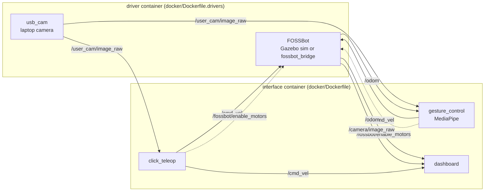

# FOSSBot Control Interface

[](https://github.com/wiktor77887-bit/fossbot-control-interface/actions/workflows/ci.yml)

ROS 2 (Jazzy) interface for driving the [FOSSBot](https://github.com/eellak/fossbot) mobile robot —
by clicking in a camera window, by hand gestures, with a live dashboard of the robot's state.
Works the same in the Gazebo simulation and on the physical robot, because both expose the
same topics (`/cmd_vel`, `/odom`, `/scan`, `/camera/image_raw`).

Project for the *Introduction to Robotics* course at Poznań University of Technology.

## Features

- [x] **Click teleoperation** – click above the centre line to drive forward, below to drive
      backward; speed grows with the distance from the centre
- [x] **Launch file + YAML parameters** – one command starts all nodes with their settings
- [x] **Live dashboard** – camera image, XY trajectory and commanded vs measured velocity
      in real time
- [x] **Gesture control** – two hand gestures (MediaPipe) trigger 360° rotations,
      closed-loop on the `/odom` yaw
- [x] **Docker Compose** – profiles `sim`, `bridge` and `real`; one container for the robot
      and camera drivers, another for the project's own nodes

## Architecture



With Docker Compose the drivers and the project's own nodes run in separate containers that
talk only over ROS 2 topics and services. In the `real` profile (bridge on another computer)
the driver container runs only `usb_cam`.

The dashboard only subscribes, so it works next to any controller (click teleop,
gestures, `teleop_twist_keyboard`, Nav2).

## Requirements

- Ubuntu 24.04 + ROS 2 Jazzy (or the FOSSBotEduSim container)
- Python packages: `opencv`, `numpy`, `matplotlib`, `PyQt5` (all installed with ROS desktop)
- Optional: [`usb_cam`](https://github.com/ros-drivers/usb_cam) for the laptop camera
  (`sudo apt install ros-jazzy-usb-cam`)
- For gesture control: MediaPipe and the hand landmarker model (already in the Docker image):
  ```bash
  sudo apt install python3-pip libgles2 libegl1
  pip install --break-system-packages mediapipe "numpy==$(python3 -c 'import numpy; print(numpy.__version__)')"
  pip uninstall --break-system-packages -y opencv-contrib-python   # keep the system OpenCV
  wget -O ~/hand_landmarker.task https://storage.googleapis.com/mediapipe-models/hand_landmarker/hand_landmarker/float16/1/hand_landmarker.task
  ```
  Pinning NumPy keeps the system matplotlib and OpenCV working. Without MediaPipe start the
  interface with `start_gestures:=false`.

## Build

```bash
mkdir -p ~/ros2_ws/src && cd ~/ros2_ws/src
git clone https://github.com/wiktor77887-bit/fossbot-control-interface.git
cd ~/ros2_ws
colcon build --symlink-install --packages-select fossbot_control_interface
source install/setup.bash
```

## Run

### With Docker Compose (recommended)

[`compose.yaml`](compose.yaml) starts two containers per profile:

- **drivers** ([`docker/Dockerfile.drivers`](docker/Dockerfile.drivers)) – the robot driver and
  `usb_cam` for the laptop camera, started by
  [`docker/drivers.launch.py`](docker/drivers.launch.py). The same Dockerfile adds `usb_cam` to
  the simulator image, the bridge image or plain `ros:jazzy` (`BASE_IMAGE` build argument).
- **interface** ([`docker/Dockerfile`](docker/Dockerfile), `ros:jazzy` + MediaPipe) – the nodes of
  this package, started with `start_camera:=false`, without access to `/dev/video0`.

Settings go to `.env`. The base images of the driver containers are built once:

```bash
cp .env.example .env              # robot address, mDNS, ROS_DOMAIN_ID, camera
docker compose build sim-base     # ros2_fossbot_edu from FOSSBOT_SIM_DIR (or its build_image.sh)
docker compose build bridge-base  # fossbot_bridge:jazzy from FOSSBOT_BRIDGE_DIR (real robot only)
xhost +local:docker               # once per login: let containers open windows
```

Use exactly **one** profile:

| Command | Driver container | Interface container |
|---|---|---|
| `docker compose --profile sim up` | `sim`: Gazebo simulation + `usb_cam` | `interface-sim` |
| `docker compose --profile bridge up` | `bridge`: [fossbot-ros2-bridge](https://github.com/LRMPUT/fossbot-ros2-bridge) + `usb_cam` | `interface-real` |
| `docker compose --profile real up` | `camera`: `usb_cam` only, the bridge runs on another computer | `interface-real` |

- **One bridge per robot.** The bridge for a given robot may run on only one computer at a time,
  so it has its own `bridge` profile. Do not start it together with the bridge's own `run.sh`,
  and do not combine `bridge` with `real` (both would open the laptop camera).
- **mDNS:** `.local` robot names (`FOSSBOT_HOST=fossbotrpi1.local`) need Avahi on the host and
  the `COMPOSE_FILE=compose.yaml:compose.mdns.yaml` line in `.env`. Without Avahi, put the robot's
  IP address in `FOSSBOT_HOST` and remove that line.
- All containers use host networking and IPC (DDS discovery, shared memory, UDP telemetry from the
  robot). The simulator limits discovery to `localhost`, so the `sim` interface does the same.
- The laptop camera (`/dev/video0`) is published as `/user_cam/image_raw`; the robot's own camera
  stays on `/camera/image_raw`. Without a camera set `START_CAMERA=false` and `VIDEO_DEVICE=/dev/null`.

Stop with `Ctrl+C` or `docker compose --profile sim --profile bridge --profile real down`.

### In simulation (local ROS 2)

```bash
# terminal 1 – simulator (inside FOSSBotEduSim)
ros2 launch fossbot_educational_description single.launch.py world:=simple_shapes.sdf

# terminal 2 – interface (+ laptop camera)
ros2 launch fossbot_control_interface interface.launch.py start_camera:=true
```

### On the real robot (local ROS 2)

Start the [fossbot-ros2-bridge](https://github.com/LRMPUT/fossbot-ros2-bridge) as described in the lab
instructions, then in every terminal:

```bash
export ROS_DOMAIN_ID=1
ros2 launch fossbot_control_interface interface.launch.py use_real_robot:=true start_camera:=true
```

`use_real_robot:=true` calls `/fossbot/enable_motors` automatically. The node publishes
`/cmd_vel` at 20 Hz while moving, because the robot stops after 0.5 s without commands.

Start only some windows with `start_click_teleop:=false`, `start_gestures:=false` or
`start_dashboard:=false`.

### Controls (click window)

| Action | Effect |
|---|---|
| Left click above the line | Drive forward for `move_duration` seconds |
| Left click below the line | Drive backward for `move_duration` seconds |
| `SPACE` / `s` | Stop |
| `q` / `ESC` / close window | Quit (sends a zero `Twist`) |

### Gesture control

| Gesture | Action |
|---|---|
| 3️⃣ **Three** – index + middle + ring finger, pinky folded | turn 360° left (counter-clockwise) |
| 🤘 **Horns** – index + pinky, middle and ring folded | turn 360° right (clockwise) |
| ✋ **Open palm** – all four fingers | abort the rotation |

None of them is used in Lab 08 (index = forward, open hand = back, thumb = left/right).
The thumb is ignored. A finger counts as extended when its tip is clearly farther from the
wrist than its middle joint, which works for any hand rotation. A gesture must be held for
`hold_frames` frames (≈ 0.3 s) and fires once: to turn again, change the pose first.

The turn is **closed-loop on the yaw from `/odom`**, not timed, because Gazebo runs at about
half real time and the real robot does not turn at exactly the commanded speed. The yaw is
summed from wrapped differences, so the ±180° jump does not matter. The speed ramps down over
the last `slow_zone` radians and the turn stops within `angle_tolerance` of 360°.

Safety:
- `/cmd_vel` is published at 20 Hz during the whole turn, because the real robot stops
  after 0.5 s without commands.
- A zero `Twist` is sent at the end, on abort, and on shutdown (Ctrl+C or SIGTERM), because the
  Gazebo DiffDrive keeps executing the last command. After that the node stays silent and does
  not fight `click_teleop`.
- The turn aborts when `/odom` stops for 0.5 s or after `rotation_timeout`. With
  `use_real_robot:=true`, turns start only after `/fossbot/enable_motors` succeeded.

Window keys: `SPACE` / `s` – abort, `q` – quit. Without a camera the turn can be started from
the terminal:

```bash
ros2 service call /gesture_control/rotate_left std_srvs/srv/Trigger
ros2 service call /gesture_control/rotate_right std_srvs/srv/Trigger
ros2 service call /gesture_control/stop std_srvs/srv/Trigger
```

### Dashboard


| Panel | Content |
|---|---|
| Camera | robot camera (`/camera/image_raw`) |
| Trajectory | XY path from `/odom`, start point, robot position and heading |
| Linear / angular velocity | last 20 s: command (`/cmd_vel`, dashed) vs measured (`/odom`) |
| Status bar | pose, yaw, velocities, distance travelled, camera FPS |

Keys: `r` – reset the trajectory and plots, `q` – quit.

A gap in the command line means nobody is publishing `/cmd_vel`. That is shown on
purpose instead of drawing zero: the real FOSSBot stops after 0.5 s of silence, but the
Gazebo DiffDrive plugin keeps executing the **last** command – the measured line makes
that visible.

The dashboard uses matplotlib with *blitting*: axes, labels and legends are rendered once
and cached, only the data is redrawn every frame (≈ 55 ms instead of ≈ 360 ms per frame on
a laptop without a GPU while Gazebo is running). Lower `refresh_rate` to save more CPU.

## Parameters

Defined in [`config/params.yaml`](fossbot_control_interface/config/params.yaml).

| Parameter | Default | Description |
|---|---|---|
| `image_topic` | `/user_cam/image_raw` | Image shown in the window |
| `cmd_vel_topic` | `/cmd_vel` | Velocity command output |
| `max_linear_speed` | `0.2` | Speed [m/s] at the window edge |
| `min_linear_speed` | `0.05` | Speed [m/s] just outside the dead zone |
| `dead_zone` | `0.05` | Ignored band around the centre (fraction of half-height) |
| `proportional_speed` | `true` | `false` = always `max_linear_speed` |
| `move_duration` | `1.0` | How long one click drives the robot [s] |
| `publish_rate` | `20.0` | `/cmd_vel` rate while moving [Hz] |
| `enable_motors_on_start` | `false` | Set by `use_real_robot:=true` |

**gesture_control**

| Parameter | Default | Description |
|---|---|---|
| `image_topic` | `/user_cam/image_raw` | Camera that sees the hand |
| `odom_topic` | `/odom` | Yaw feedback for the turn |
| `model_path` | `~/hand_landmarker.task` | MediaPipe hand landmarker model |
| `max_angular_speed` / `min_angular_speed` | `0.8` / `0.2` | Turn speed [rad/s], full / at the end |
| `slow_zone` | `0.6` | Slow down over the last [rad] of the turn |
| `angle_tolerance` | `0.02` | Stop this close to 360° [rad] |
| `hold_frames` | `5` | Frames a gesture must be held |
| `finger_ratio` | `1.2` | Tip/joint distance ratio for an extended finger |
| `publish_rate` | `20.0` | `/cmd_vel` rate during the turn [Hz] |
| `odom_timeout` / `rotation_timeout` | `0.5` / `30.0` | Abort limits [s] |
| `show_window` / `mirror_preview` | `true` / `true` | Preview window with the hand skeleton |
| `enable_motors_on_start` | `false` | Set by `use_real_robot:=true` |

**dashboard**

| Parameter | Default | Description |
|---|---|---|
| `odom_topic` | `/odom` | Pose and measured velocity |
| `cmd_vel_topic` | `/cmd_vel` | Commanded velocity |
| `image_topic` | `/camera/image_raw` | Robot camera |
| `history` | `20.0` | Time span of the velocity plots [s] |
| `refresh_rate` | `10.0` | GUI refresh rate [Hz] |
| `image_scale` | `0.5` | Camera image downsampling before drawing |
| `trajectory_min_step` | `0.01` | Store a path point after moving this far [m] |
| `trajectory_max_points` | `5000` | Path length limit (oldest points dropped) |

## Notes from testing

- Without a GPU Gazebo runs at a **real-time factor of ≈ 0.5** (measured from `/clock`), so
  a 1 s click moves the simulated robot half as far as on the real robot. Anything that must
  reach a target (e.g. a 360° turn) therefore uses `/odom` feedback, not timing.

## Tests

```bash
cd ~/ros2_ws
colcon test --packages-select fossbot_control_interface --event-handlers console_direct+
colcon test-result --verbose
```

Besides the unit tests this runs the ROS 2 style linters `ament_flake8` and `ament_pep257`.
GitHub Actions ([`.github/workflows/ci.yml`](.github/workflows/ci.yml)) builds the package and
runs the same tests in the `ros:jazzy` container on every push and pull request.

## Project structure

```
compose.yaml                         # Docker Compose: profiles sim / bridge / real
compose.mdns.yaml                    # mounts the host Avahi socket for .local names
docker/Dockerfile                    # interface image (ros:jazzy + MediaPipe + this package)
docker/Dockerfile.drivers            # driver image (BASE_IMAGE + usb_cam)
docker/drivers.launch.py             # simulator / bridge + usb_cam in the driver container
fossbot_control_interface/
├── config/params.yaml               # node parameters
├── launch/interface.launch.py       # starts all nodes
├── fossbot_control_interface/
│   ├── click_teleop.py              # ROS 2 node: click window -> /cmd_vel
│   ├── click_logic.py               # pure click -> velocity mapping (unit tested)
│   ├── dashboard.py                 # ROS 2 node: matplotlib dashboard window
│   ├── gesture_control.py           # ROS 2 node: MediaPipe gestures -> 360° turns
│   ├── gesture_logic.py             # gesture rules, debouncing, yaw tracking (unit tested)
│   ├── dashboard_logic.py           # time series, trajectory, axis limits (unit tested)
│   └── image_utils.py               # sensor_msgs/Image -> OpenCV without cv_bridge
└── test/                            # pytest unit tests + ament lint tests
```

## License

MIT – see [LICENSE](LICENSE).
